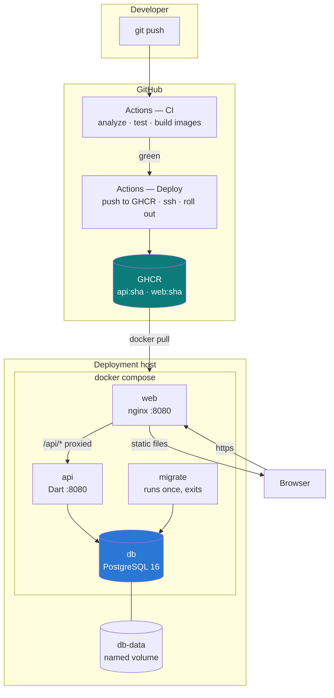

# Deploying Stockpile

Three containers, one database volume, and a pipeline that builds them on
every push. This describes how they fit together, how to run the stack, and
what to do when a release goes wrong.

## The shape of it



**Why the client is served by the proxy.** The Flutter web bundle is built
with a *relative* API base (`/api`), and nginx proxies that onward to the API
container. Two things follow: the same image is valid in every environment —
nothing about staging or production is compiled in — and the browser only ever
talks to its own origin, so CORS never applies. The mobile builds pass an
absolute URL instead, which the client resolves differently on purpose
(`AuthApi.endpointFor`).

**There is no cache or message queue.** The application has no work that needs
one. The only in-memory state is the API's flood guard, and the protections
that matter — account lockout, token issue caps, sessions — are all in
PostgreSQL and therefore shared across replicas. If a queue is ever added,
this is the file to update.

## Running it locally

```bash
cp .env.example .env
# POSTGRES_PASSWORD and TOKEN_PEPPER have no defaults; the stack refuses to
# start without them. Generate both:
#   openssl rand -base64 24
#   openssl rand -base64 32

docker compose up --build
open http://localhost:8080
```

`docker compose up` builds from source, waits for PostgreSQL to be healthy,
runs migrations to completion, and only then starts the API and the web
server. The first build downloads the Flutter SDK and takes a while; after
that the dependency layers are cached.

Create the first administrator:

```bash
docker compose run --rm --entrypoint /app/bin/create_admin api \
  --email you@example.com --name "Your Name"
```

It prints a single-use invitation link. No password is ever typed on a command
line or left in a shell history.

Useful commands:

```bash
docker compose ps                       # health of every container
docker compose logs -f api              # follow one service
docker compose exec db psql -U stockpile stockpile
docker compose down                     # stop, keep the data
docker compose down -v                  # stop and destroy the database
```

## Deploying

### What the host needs

- Docker Engine with the Compose plugin.
- **rsync** — the deploy syncs the compose file and the deploy script with it.
  `sudo dnf install -y rsync` on this host (RHEL/Rocky), `apt-get` on
  Debian/Ubuntu. The workflow checks for it and says so
  rather than failing on rsync's exit 127.
- A directory to deploy into, owned by the deploy user.
- SSH on port 22, or `DEPLOY_PORT` set to whatever it listens on.
- **A host nginx with a certificate**, proxying to `127.0.0.1:8080`. Required,
  not optional: `web` binds to loopback, so without it the app is reachable
  from nowhere. The working vhost is committed at
  `deploy/nginx/store.chedraolympas.com.conf`.

  It is **not** installed by the deploy — that is a one-time `sudo` step, and
  the deploy has no business editing a file shared with the other sites on
  that host. Copy it to `/etc/nginx/conf.d/`, then `nginx -t` before any
  reload.

  That host is shared: `assetmanagement.oasisproducts.ng` (Snipe-IT) and
  `sslmonitor.oasisproducts.ng` run there too, and Snipe-IT owns
  `default_server`. The vhost deliberately does not claim it — nginx allows
  one per address:port, and a second makes `nginx -t` fail, which turns every
  later `reload` into a silent no-op and would take all three sites down on a
  restart.

### Secrets and variables

The deploy workflow assembles the host's `.env` entirely from these, so
nothing sensitive is committed and nothing is typed on the host by hand.

**Repository secrets** (Settings → Secrets and variables → Actions):

| Secret | What it is |
|---|---|
| `DEPLOY_HOST` | Hostname or IP of the deployment host. **Leave unset and the deploy step skips cleanly** — images are still published. |
| `DEPLOY_USER` | SSH user. |
| `DEPLOY_PATH` | Absolute path to the deploy directory. |
| `DEPLOY_SSH_KEY` | Private key, whole file including the header line. |
| `DEPLOY_KNOWN_HOSTS` | Output of `ssh-keyscan <host>`. Pinned rather than disabling host checking, which would accept whatever answers on that address. |
| `POSTGRES_PASSWORD` | Database password. |
| `TOKEN_PEPPER` | ≥32 characters. Changing it signs everyone out and voids outstanding reset links. |
| `EMAIL_HOST`, `EMAIL_USERNAME`, `EMAIL_PASSWORD` | SMTP. For Gmail this must be an app password. |

**Repository variables** (not secret): `APP_URL`, `EMAIL_PORT`, `EMAIL_FROM`.

No registry credential is needed: the workflow pushes to GHCR with the run's
own `GITHUB_TOKEN`.

### What a deploy does

`main` deploys to production, `develop` to staging.

The compose file and the deploy script are **rsynced** into the deploy
directory as a mirror: only changed bytes cross the wire, modes are preserved
so `deploy.sh` arrives executable, and `--delete` means a file removed from
the repository stops lingering on the host.

`.env` and `.previous-tag` are excluded from that mirror, and the exclusion is
load-bearing rather than tidiness. Both are written *on the host* — one by the
workflow, one by `deploy.sh` to record what to roll back to — so a `--delete`
without them would erase the database password and the rollback target on
every deploy.

The environment file is never rsynced. It is written over the SSH pipe, so it
is never a file on the runner's disk.

Then `scripts/deploy.sh` runs on the host, which:

1. **Pulls first.** A bad tag or an unreachable registry fails while the
   current release is still serving.
2. **Records what is running** — read from the running containers, not from a
   file, because those disagree exactly when a previous deploy failed halfway.
3. **Migrates as its own step**, to completion, before any new API container
   serves. Two replicas racing to create the same table is the failure this
   avoids.
4. **Starts with `--wait`**, so a container that starts and immediately falls
   over is a failed deploy rather than a silent one.
5. **Rolls back** to the recorded tag if health never arrives.

The workflow then checks `APP_URL/healthz` from outside the host: containers
reporting healthy to themselves is not the same as the site answering.

### Environments and approval

The deploy job declares a GitHub environment, so production can require a
review before the job starts: Settings → Environments → `production` →
*Required reviewers*. Nothing is published or deployed until it is approved.

### Staging is this machine

`main` deploys to production. Nothing else deploys anywhere: staging runs in
Docker on a developer's own machine.

```bash
./scripts/staging-up.sh            # build the working tree, bring the stack up
./scripts/staging-up.sh --fresh    # the same, on an empty database
```

It serves on `WEB_PORT` from `.env`, and verifies rather than assumes —
`docker compose up` answering on the port proves only that *something* is
listening, and a stack left from an earlier build answers identically. So it
checks the running schema against `schemaVersion` in the source, checks the
`categories` table exists, checks the bundle being served hashes to the
`main.dart.js` inside the image, and checks the API answers `401` rather than
`404` through the proxy. Any mismatch fails the script.

**Why there is no remote staging.** Every `DEPLOY_*` value is a repository
secret shared by both environments, and the environment name only ever reached
the job's title — so a push to `develop` would have announced "Deploy to
staging" and then rsynced to the *production* host, over the production path,
restarting the live stack against the live database. A hosted runner cannot
reach a developer's Docker either way, so the workflow publishes the images
for a non-production branch, tags them with the branch, and stops.

Giving staging a real host later means environment-scoped secrets — its own
host, path, known-hosts entry, URL, database password, and **its own
`TOKEN_PEPPER`**, since the pepper is what makes a session token valid and one
pepper across both environments means a token minted on staging is accepted by
production.

## First-time host setup

One thing is done once, by hand, on the host. It does not belong in the deploy
workflow: the first administrator is an account, not an artefact.

### Creating the first administrator

There is no seeded account and no default password. The first administrator is
created on the host, against the running stack:

```bash
cd "$DEPLOY_PATH"
docker compose -f docker-compose.prod.yml run --rm \
  --entrypoint /app/bin/create_admin api \
  --email you@example.com --name "Your Name"
```

The account is created *pending, with no password*. The command prints a
single-use invitation link and — because production has SMTP configured —
emails the same link to the address. Open it, choose a password there. No
password is typed on a command line or left in a shell history.

The link is good for 72 hours — the command prints the exact figure. The
prod compose file does not pass `INVITATION_TTL_HOURS` through, so setting it
in `.env` alone has no effect; change the compose file if you want a different
window.

It is a bootstrap, not a general user-creation tool: it refuses to run once
any administrator exists, pending or active, and tells you to invite further
users from the app instead. Two cases need `--force`:

```bash
# The invitation expired before it was claimed, or went to the wrong address.
docker compose -f docker-compose.prod.yml run --rm \
  --entrypoint /app/bin/create_admin api \
  --email you@example.com --name "Your Name" --force
```

`--force` creates an additional administrator, so prefer inviting from the app
whenever you can still sign in. It is the way back when you cannot.

## Rolling back

Images are tagged with the commit SHA, so a rollback is a redeploy of a known
tag rather than a revert-and-rebuild.

**From GitHub:** Actions → Deploy → *Run workflow* → choose the environment
and put a previous 12-character SHA in `image_tag`.

**On the host:**

```bash
cd /path/to/deploy
./deploy.sh 4f2a9c8b1d3e     # any previously published tag
```

Both paths run the same script, so a rollback gets the same health gate as a
deploy.

**On migrations.** The rollback path deliberately does *not* re-run them.
Migrations are forward-only, and the previous release's code has to tolerate
the newer schema — which is true of additive changes, and is what these are.
A destructive migration would break that assumption and needs a considered
manual step: restore the volume from backup, then deploy the older tag.

## Health, logging and monitoring

Every container has a healthcheck, and Compose gates startup on them:

| Container | Check | Why that one |
|---|---|---|
| `db` | `pg_isready -U … -d …` | The bare command reports the *server*, which is ready before this database is — so the API would still race it on a first run. |
| `api` | `GET /health` | The process can be listening while its database connection is gone; a port check would call that healthy. |
| `web` | `GET /healthz` | Served by nginx itself, not proxied, so it reports on this container rather than the API behind it. |

Logs go to the container's stdout and are rotated by the json-file driver at
10 MB × 3 per container, so a chatty week cannot fill the disk. nginx logs
access as JSON, one object per line, which any collector can parse without a
regex. To ship them somewhere, point a log driver at it — the driver is set
per service in the compose files and is the only thing that changes:

```yaml
logging:
  driver: loki          # or gelf, awslogs, fluentd
  options:
    loki-url: https://loki.example.com/loki/api/v1/push
```

`restart: always` brings containers back after a crash or a host reboot; the
API additionally caps at three consecutive failures so a genuinely broken
release stops thrashing and stays visible in `docker compose ps`.

## Names

Deliberately short, because `docker ps` shows them and a long repository path
pushes every other column off the screen:

| | |
|---|---|
| images, in the registry | `ghcr.io/<owner>/inv/api:<sha>`, `…/inv/web:<sha>` |
| images, on the host | `inv/api:<sha>`, `inv/web:<sha>` |
| containers | `inv-api-1`, `inv-db-1`, `inv-web-1` |
| volume | `inv-db-data` |

The host name is short on purpose. `deploy.sh` pulls the registry copy,
`docker tag`s it to `inv/<service>:<sha>` and drops the registry reference, so
`docker ps` reads `inv/api:36b08a5a` rather than sixty characters of path.
Both names are the same image — tagging costs nothing and copies nothing.

That is also why the compose file carries `pull_policy: never` on `api`, `web`
and `migrate`: `inv/api` exists only on this host, and without it Compose
would try Docker Hub and fail. Only `db`, a genuine public image, is pulled by
Compose in the ordinary way.

The volume's name is set **explicitly** rather than left to Compose, which
would prefix it with the project name. Without that, renaming the project
would silently point the database at a brand new empty volume — indis­tinguish­able
from total data loss.

The project was previously called `stockpile`. Compose keys containers, the
network and `docker compose down` on that name, so a host that ran the old one
keeps those containers alive and **holding the published port**, and the new
stack then fails to bind. `deploy.sh` stops the old project automatically and
is a no-op on a host that never ran it. The old volume is left alone — moving
or deleting data is not the deploy's business:

```bash
docker volume ls | grep stockpile          # is there anything there?
docker volume rm stockpile_db-data         # once you are sure
```

## Database

PostgreSQL 16 with a named volume, `db-data`. Named rather than anonymous, so
`docker compose down` keeps the data and only `down -v` destroys it.

**TLS to the database** is decided by the connection string, not by
`APP_ENV`. The bundled `db` container is on the compose network and the
official postgres image ships without TLS, so requiring it there would fail
every connection — the compose files therefore pass `?sslmode=disable`, and
the traffic never leaves the Docker bridge. Point `DATABASE_URL` at a managed
database instead and add `?sslmode=require`; the server will then insist on
TLS and refuse a plaintext connection.

Migrations are drift's, and they run in two places: the server applies them at
boot, and `bin/migrate` applies them as a discrete deploy step. Both are
idempotent — drift applies only what the database has not seen, and the
permission and role seed is an upsert.

Back it up before every production deploy that changes the schema:

```bash
docker compose exec -T db pg_dump -U stockpile stockpile | gzip > backup-$(date +%F).sql.gz

# restore
gunzip -c backup-2026-09-10.sql.gz | docker compose exec -T db psql -U stockpile stockpile
```

The volume survives `docker compose down`, image updates and host reboots. It
does not survive `down -v`, and it is not a backup — it is on the same disk as
everything else.

## When something is wrong

```bash
docker compose ps                    # which container is unhealthy
docker compose logs --tail 100 api
docker compose exec db pg_isready -U stockpile -d stockpile
curl -fsS http://localhost:8080/healthz          # the web container
docker compose exec web wget -qO- http://api:8080/health   # the API, from inside
```

**The API restarts in a loop.** Almost always configuration: it refuses to
start rather than run insecurely. `docker compose logs api` names the missing
variable — in production `TOKEN_PEPPER`, `EMAIL_HOST` and an `https://`
`APP_URL` are all mandatory.

**The web container is healthy but the app cannot sign in.** The proxy is not
reaching the API. Check `docker compose logs web` for upstream errors, and
that `API_UPSTREAM` matches the service name.

**A deploy hung on migrations.** The migrate container retries a slow database
for about a minute, then exits `75`. The previous release keeps serving
throughout; nothing is replaced until migrations succeed.
